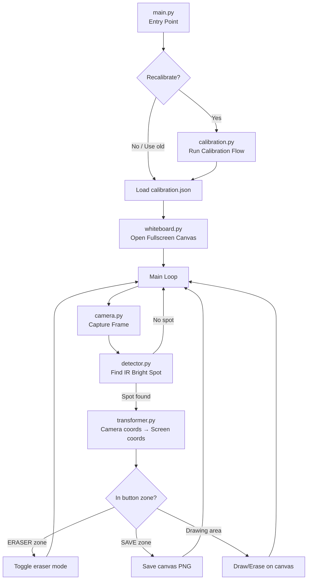
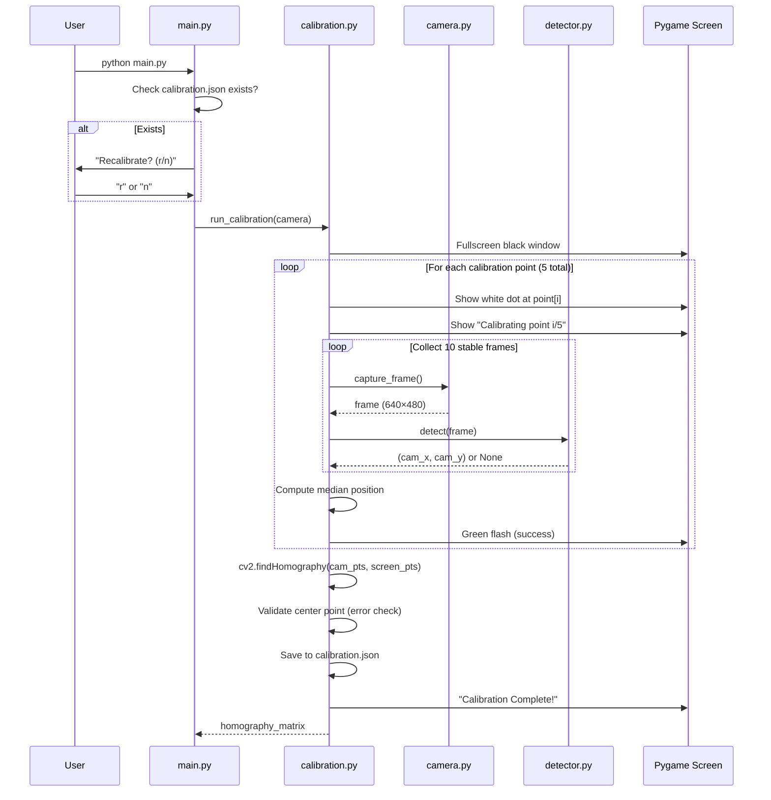
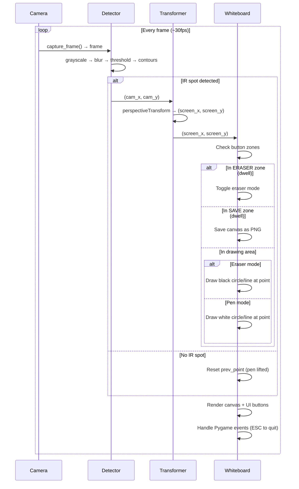

# 📒 Smart Notebook — Complete Implementation Plan

> **Project**: Smart Notebook (IR Pen Whiteboard for Raspberry Pi)
> **Hardware**: Raspberry Pi 3B+ · RPi OS 64-bit · OV5647 IR 1080p Camera · 1080p HDMI Monitor
> **Date**: 2026-10-24
> **Purpose**: This document is the single source of truth for implementing the entire project. It is written so that **any LLM or developer can follow it end-to-end** and produce working code.

---

## Table of Contents

1. [Project Overview](#1-project-overview)
2. [Physical Setup & Hardware Context](#2-physical-setup--hardware-context)
3. [Repository Structure](#3-repository-structure)
4. [Dependencies & Environment](#4-dependencies--environment)
5. [Architecture Overview](#5-architecture-overview)
6. [Module-by-Module Specification](#6-module-by-module-specification)
   - 6.1 [main.py — Entry Point](#61-mainpy--entry-point)
   - 6.2 [camera.py — Camera Capture](#62-camerapy--camera-capture)
   - 6.3 [calibration.py — Display-Camera Calibration](#63-calibrationpy--display-camera-calibration)
   - 6.4 [detector.py — IR/White Light Detection](#64-detectorpy--irwhite-light-detection)
   - 6.5 [whiteboard.py — Whiteboard Canvas & UI](#65-whiteboardpy--whiteboard-canvas--ui)
   - 6.6 [transformer.py — Coordinate Transformation](#66-transformerpy--coordinate-transformation)
   - 6.7 [config.py — Configuration Constants](#67-configpy--configuration-constants)
7. [Calibration Flow — Step by Step](#7-calibration-flow--step-by-step)
8. [Whiteboard Flow — Step by Step](#8-whiteboard-flow--step-by-step)
9. [IR Pen Detection Algorithm](#9-ir-pen-detection-algorithm)
10. [Coordinate Mapping (Homography)](#10-coordinate-mapping-homography)
11. [UI Layout & Button Zones](#11-ui-layout--button-zones)
12. [Edge Cases & Error Handling](#12-edge-cases--error-handling)
13. [Performance Considerations (RPi 3B+)](#13-performance-considerations-rpi-3b)
14. [Testing Strategy](#14-testing-strategy)
15. [Git Setup (.gitignore, requirements.txt)](#15-git-setup-gitignore-requirementstxt)
16. [Quick Start / How to Run](#16-quick-start--how-to-run)

---

## 1. Project Overview

**Smart Notebook** turns a Raspberry Pi + IR camera + HDMI monitor into an interactive whiteboard. The user holds an **IR pen** (an IR LED with a push button). When pressed, the IR light is detected by the camera, its position is mapped to the screen via a calibration homography, and a white line is drawn on a black canvas in real-time.

### Core Features (v1)

| Feature | Description |
|---|---|
| **Calibration** | Camera-to-display coordinate mapping using 5 calibration dots |
| **Production Mode** | Clean fullscreen whiteboard canvas with white pen on black background |
| **Testing / Dev Mode** | Simultaneous whiteboard + live camera tracking feed, OpenCV threshold mask, and telemetry HUD |
| **Eraser** | On-screen button zone — point IR pen at it to toggle eraser mode |
| **Save** | On-screen button zone — point IR pen at it to save canvas as PNG |
| **Persistence** | Calibration data saved to JSON, reusable across sessions |

### What the IR Pen Is

A simple physical device: an IR LED (850nm or 940nm) powered by a small battery, with a **momentary push button**. When the button is pressed, the LED emits IR light. When released, it stops. The camera sees this as an extremely bright white spot.

---

## 2. Physical Setup & Hardware Context

```
┌─────────────────────────────────────────────┐
│                HDMI Monitor                  │
│          (1920×1080, fullscreen)             │
│                                              │
│   ┌──────────────────────────────────────┐   │
│   │        WHITEBOARD CANVAS             │   │
│   │        (full black)                  │   │
│   │                                      │   │
│   │    User draws here with IR pen       │   │
│   │                                      │   │
│   │                                      │   │
│   │                          [ERASER]    │   │
│   │                          [SAVE]      │   │
│   └──────────────────────────────────────┘   │
└─────────────────────────────────────────────┘
          ▲
          │  Camera sees this display
          │  (from some angle/distance)
          │
    ┌─────┴─────┐
    │  OV5647   │  ← mounted on tripod or shelf
    │ IR Camera │     facing the monitor
    └─────┬─────┘
          │ ribbon cable
    ┌─────┴─────┐
    │   RPi 3B+ │
    └───────────┘
```

> [!IMPORTANT]
> The camera does **NOT** see a perfect rectangle of the display. It sees it from an angle, so the display appears as a **trapezoid/quadrilateral** in the camera frame. This is exactly why we need **homography calibration** — to map the distorted camera coordinates to the correct display pixel coordinates.

### Camera Details

- **Sensor**: OV5647
- **Resolution**: 1080p (1920×1080) — but we will capture at **640×480 for speed** on RPi 3B+
- **IR Capability**: The OV5647 module comes in two variants. The user's camera detects "all light" which suggests it's either a **NoIR variant** (no IR filter) or has the IR filter removed. This is ideal for IR pen detection.
- **Connection**: CSI ribbon cable to RPi's onboard camera port

---

## 3. Repository Structure

```
Book/
├── main.py                  # Entry point — run this
├── camera.py                # Camera capture (picamera2)
├── calibration.py           # Calibration flow & data persistence
├── detector.py              # IR/bright-white light detection
├── whiteboard.py            # Pygame whiteboard canvas & UI
├── transformer.py           # Homography coordinate transformation
├── config.py                # All constants and configuration
├── requirements.txt         # Python dependencies
├── .gitignore               # Git ignore rules
├── README.md                # Project documentation
├── calibration_data/        # Stored calibration (gitignored)
│   └── calibration.json     # Saved homography matrix + metadata
└── saves/                   # Saved whiteboard images (gitignored)
    └── (PNG files)
```

---

## 4. Dependencies & Environment

### requirements.txt

```
opencv-python-headless==4.9.0.80
numpy==1.26.4
pygame==2.5.2
picamera2==0.3.19
```

> [!NOTE]
> - `opencv-python-headless` is used instead of `opencv-python` because we use Pygame for display, not OpenCV's highgui. This avoids pulling in heavy GTK/Qt dependencies.
> - `picamera2` is **pre-installed** on Raspberry Pi OS 64-bit. It's in requirements.txt for documentation but will already be available.
> - On RPi OS 64-bit, `libcamera` and its Python bindings come pre-installed. `picamera2` depends on them.
> - `numpy` is also typically pre-installed but listed for version pinning.

### System Dependencies (pre-installed on RPi OS)

These do NOT need to be installed via pip — they come with the OS:

- `libcamera` (camera stack)
- `python3-libcamera` (Python bindings)
- `python3-kms++` (display/KMS bindings used by picamera2)
- `SDL2` libraries (used by Pygame, pre-installed)

### Install Command (on RPi)

```bash
cd ~/Book
pip install -r requirements.txt --break-system-packages
```

> [!TIP]
> The `--break-system-packages` flag is needed on RPi OS Bookworm (Debian 12) which uses externally-managed Python. Alternatively, use a venv:
> ```bash
> python3 -m venv venv --system-site-packages
> source venv/bin/activate
> pip install -r requirements.txt
> ```
> The `--system-site-packages` flag is **critical** so the venv can access the pre-installed `picamera2` and `libcamera` packages.

---

## 5. Architecture Overview



### Data Flow Per Frame

```
Camera Frame (640×480 BGR)
    → Grayscale conversion
    → Threshold (very high ~240-252)
    → Find contours
    → Largest bright blob = IR pen position (cx, cy) in camera space
    → Homography transform → (sx, sy) in screen space (1920×1080)
    → Check if (sx, sy) is in a button zone
    → If not, draw white circle/line at (sx, sy) on Pygame surface
    → Pygame display update
```

---

## 6. Module-by-Module Specification

### 6.1 `main.py` — Entry Point

**Purpose**: Launch the application. Ask the user whether to recalibrate or use existing data. Orchestrate the full lifecycle.

**Pseudocode**:

```python
import sys
from config import CALIBRATION_FILE
from calibration import run_calibration, load_calibration, calibration_exists
from whiteboard import Whiteboard
from camera import Camera
from detector import IRDetector
from transformer import CoordinateTransformer

def main():
    camera = Camera()
    camera.start()

    # Ask user: recalibrate or use old?
    if calibration_exists():
        print("Existing calibration found.")
        print("Press 'r' to recalibrate, or any other key to use existing data...")
        # Read single keypress from terminal
        choice = input("Recalibrate? (r/n): ").strip().lower()
        if choice == 'r':
            homography_matrix = run_calibration(camera)
        else:
            homography_matrix = load_calibration()
    else:
        print("No calibration data found. Running calibration...")
        homography_matrix = run_calibration(camera)

    transformer = CoordinateTransformer(homography_matrix)
    detector = IRDetector()
    whiteboard = Whiteboard()

    # Main loop
    try:
        while True:
            frame = camera.capture_frame()
            ir_point = detector.detect(frame)

            if ir_point is not None:
                screen_point = transformer.transform(ir_point)
                whiteboard.handle_point(screen_point)
            else:
                whiteboard.handle_no_point()

            whiteboard.render()

            if whiteboard.should_quit():
                break
    finally:
        camera.stop()
        whiteboard.cleanup()

if __name__ == "__main__":
    main()
```

**Key Behaviors**:
- On startup, check for `calibration_data/calibration.json`
- If exists → ask recalibrate (terminal input, simple `r` or `n`)
- If not exists → force calibration
- After calibration → enter whiteboard main loop
- Quit via ESC key on the Pygame window

---

### 6.2 `camera.py` — Camera Capture

**Purpose**: Manage the camera lifecycle (start, capture, stop). Supports both Raspberry Pi CSI ribbon cable camera and USB/Windows/Linux webcams.

**Camera Options Supported**:
- **Ribbon cable (RPi CSI)**: Uses `picamera2` (the modern Raspberry Pi camera stack).
- **USB / Windows / Regular Linux**: Uses `cv2.VideoCapture` via OpenCV (DirectShow on Windows, V4L2 on Linux).
- **Auto-detect**: Tries ribbon cable (`picamera2`) first, falls back to USB webcam (`cv2.VideoCapture`).
- Configurable via CLI (`--camera ribbon`, `--camera usb`, `--device 0`), interactive startup prompt, or `CAMERA_BACKEND` in `config.py`.

**Key Design Decisions**:
- Capture at **640×480** resolution for performance on RPi 3B+
- Use `picamera2` library (the modern RPi camera stack)
- Return frames as **numpy arrays (BGR format)** for OpenCV compatibility

**Class: `Camera`**:

```python
from picamera2 import Picamera2
import numpy as np
from config import CAMERA_WIDTH, CAMERA_HEIGHT

class Camera:
    def __init__(self):
        self.picam2 = Picamera2()
        config = self.picam2.create_preview_configuration(
            main={"size": (CAMERA_WIDTH, CAMERA_HEIGHT), "format": "RGB888"}
        )
        self.picam2.configure(config)

    def start(self):
        self.picam2.start()

    def capture_frame(self) -> np.ndarray:
        """Capture a single frame. Returns numpy array in RGB format."""
        frame = self.picam2.capture_array()
        return frame  # RGB format, shape (480, 640, 3)

    def stop(self):
        self.picam2.stop()
        self.picam2.close()
```

> [!NOTE]
> `picamera2` returns RGB by default with `"format": "RGB888"`. When passing to OpenCV for processing, convert to grayscale directly — no BGR conversion needed since we only use grayscale for detection.

**Error Handling**:
- If camera fails to initialize → print clear error message ("Camera not detected. Check ribbon cable connection.") and `sys.exit(1)`
- Wrap `Picamera2()` init in try/except

---

### 6.3 `calibration.py` — Display-Camera Calibration

**Purpose**: Show calibration dots on screen one at a time, detect each dot's position in the camera frame, compute the homography matrix, and save it.

**Calibration Points** (5 points on the 1920×1080 display):

| Point | Screen Position (x, y) | Description |
|-------|----------------------|-------------|
| 1 | (100, 100) | Top-left (with margin) |
| 2 | (1820, 100) | Top-right (with margin) |
| 3 | (1820, 980) | Bottom-right (with margin) |
| 4 | (100, 980) | Bottom-left (with margin) |
| 5 | (960, 540) | Center |

> [!IMPORTANT]
> We use 5 points but only 4 are needed for homography. The 5th (center) point serves as a **validation point** — after computing the homography from the 4 corners, we transform the center camera point and check if it maps close to (960, 540). If the error is too large (>30px), warn the user that calibration may be inaccurate.

**Calibration Procedure**:

1. Open a **fullscreen Pygame window** (black background)
2. For each calibration point:
   a. Draw a **large bright white filled circle** (radius 30px) at the screen position, plus a smaller **crosshair** for precision
   b. Wait for the camera to detect the bright dot (the display itself emits visible/IR-range light that the camera picks up)
   c. Record the detected camera coordinates `(cam_x, cam_y)`
   d. Brief pause, then move to next point
3. Compute **homography matrix** using `cv2.findHomography(camera_points, screen_points)`
4. Validate with 5th point
5. Save to `calibration_data/calibration.json`

**Detection of Calibration Dots**:

During calibration, the screen shows a single bright white dot on an otherwise black screen. The camera sees this as the only bright spot in the frame (the rest of the monitor area is dark). We use the **same IR detection logic** (threshold + contour) to find it.

**Wait Logic**: After displaying each dot, wait up to **3 seconds** for stable detection. Take **10 consecutive frames**, find the median position to reduce jitter. If no detection after 3 seconds, retry that point (re-flash the dot). After 3 retries, abort calibration with an error.

**Class: `Calibration`** / Functions:

```python
import json
import os
import numpy as np
import cv2
import pygame
from config import (SCREEN_WIDTH, SCREEN_HEIGHT, CALIBRATION_FILE,
                    CALIBRATION_POINTS, CALIBRATION_DOT_RADIUS,
                    CALIBRATION_FRAMES, CALIBRATION_TIMEOUT_SEC)
from detector import IRDetector

def calibration_exists() -> bool:
    return os.path.exists(CALIBRATION_FILE)

def load_calibration() -> np.ndarray:
    """Load homography matrix from JSON file."""
    with open(CALIBRATION_FILE, 'r') as f:
        data = json.load(f)
    return np.array(data['homography_matrix'])

def save_calibration(matrix: np.ndarray):
    """Save homography matrix to JSON file."""
    os.makedirs(os.path.dirname(CALIBRATION_FILE), exist_ok=True)
    data = {
        'homography_matrix': matrix.tolist(),
        'screen_resolution': [SCREEN_WIDTH, SCREEN_HEIGHT],
        'calibration_points': CALIBRATION_POINTS
    }
    with open(CALIBRATION_FILE, 'w') as f:
        json.dump(data, f, indent=2)

def run_calibration(camera) -> np.ndarray:
    """
    Full calibration flow:
    1. Show dots on screen
    2. Detect dot positions in camera
    3. Compute homography
    4. Save and return the matrix
    """
    pygame.init()
    screen = pygame.display.set_mode((SCREEN_WIDTH, SCREEN_HEIGHT), pygame.FULLSCREEN)
    pygame.display.set_caption("Smart Notebook - Calibration")
    detector = IRDetector()

    screen_pts = []
    camera_pts = []

    for i, (sx, sy) in enumerate(CALIBRATION_POINTS):
        # Show instruction
        screen.fill((0, 0, 0))
        # Draw the calibration dot
        pygame.draw.circle(screen, (255, 255, 255), (sx, sy), CALIBRATION_DOT_RADIUS)
        # Draw crosshair
        pygame.draw.line(screen, (255, 255, 255), (sx - 40, sy), (sx + 40, sy), 2)
        pygame.draw.line(screen, (255, 255, 255), (sx, sy - 40), (sx, sy + 40), 2)
        # Draw point number text
        font = pygame.font.SysFont(None, 36)
        text = font.render(f"Calibrating point {i+1}/{len(CALIBRATION_POINTS)}", True, (100, 100, 100))
        screen.blit(text, (SCREEN_WIDTH//2 - text.get_width()//2, 30))
        pygame.display.flip()

        # Wait a moment for display to stabilize
        pygame.time.wait(500)

        # Collect multiple frames for median
        detected_positions = []
        max_frames = CALIBRATION_FRAMES
        timeout_frames = int(CALIBRATION_TIMEOUT_SEC * 30)  # ~30fps

        for _ in range(timeout_frames):
            # Handle Pygame events (prevent freeze)
            for event in pygame.event.get():
                if event.type == pygame.QUIT:
                    pygame.quit()
                    raise SystemExit("Calibration aborted.")

            frame = camera.capture_frame()
            point = detector.detect(frame)
            if point is not None:
                detected_positions.append(point)
                if len(detected_positions) >= max_frames:
                    break

        if len(detected_positions) < max_frames // 2:
            raise RuntimeError(
                f"Calibration failed at point {i+1}. "
                f"Only detected {len(detected_positions)} positions. "
                "Check camera alignment and ambient light."
            )

        # Take median for stability
        positions = np.array(detected_positions)
        median_x = np.median(positions[:, 0])
        median_y = np.median(positions[:, 1])

        camera_pts.append([median_x, median_y])
        screen_pts.append([sx, sy])

        # Brief green flash to indicate success
        pygame.draw.circle(screen, (0, 255, 0), (sx, sy), CALIBRATION_DOT_RADIUS)
        pygame.display.flip()
        pygame.time.wait(300)

    # Compute homography (use first 4 points)
    src = np.array(camera_pts[:4], dtype=np.float32)
    dst = np.array(screen_pts[:4], dtype=np.float32)
    homography, status = cv2.findHomography(src, dst)

    # Validate with 5th point (center)
    if len(camera_pts) >= 5:
        test_pt = np.array([[camera_pts[4]]], dtype=np.float32)
        mapped = cv2.perspectiveTransform(test_pt, homography)
        mapped_x, mapped_y = mapped[0][0]
        expected_x, expected_y = screen_pts[4]
        error = np.sqrt((mapped_x - expected_x)**2 + (mapped_y - expected_y)**2)
        print(f"Calibration validation: center point error = {error:.1f}px")
        if error > 50:
            print("WARNING: Calibration may be inaccurate. Consider recalibrating.")

    # Save
    save_calibration(homography)
    print("Calibration saved successfully.")

    # Show success message briefly
    screen.fill((0, 0, 0))
    font = pygame.font.SysFont(None, 48)
    text = font.render("Calibration Complete!", True, (0, 255, 0))
    screen.blit(text, (SCREEN_WIDTH//2 - text.get_width()//2, SCREEN_HEIGHT//2 - 24))
    pygame.display.flip()
    pygame.time.wait(1500)

    pygame.quit()
    return homography
```

---

### 6.4 `detector.py` — IR/White Light Detection

**Purpose**: Given a camera frame, detect the position of the IR pen's bright spot. Return the centroid `(x, y)` or `None` if no bright spot is found.

**Algorithm** (detailed in [Section 9](#9-ir-pen-detection-algorithm)):

```python
import cv2
import numpy as np
from config import (IR_THRESHOLD, IR_MIN_AREA, IR_MAX_AREA)

class IRDetector:
    def detect(self, frame: np.ndarray):
        """
        Detect the brightest spot (IR pen) in the frame.

        Args:
            frame: RGB image as numpy array (H, W, 3)

        Returns:
            (x, y) tuple of the centroid in camera coordinates, or None
        """
        # Convert to grayscale
        gray = cv2.cvtColor(frame, cv2.COLOR_RGB2GRAY)

        # Apply Gaussian blur to reduce noise
        blurred = cv2.GaussianBlur(gray, (5, 5), 0)

        # Threshold — only keep extremely bright pixels
        _, thresh = cv2.threshold(blurred, IR_THRESHOLD, 255, cv2.THRESH_BINARY)

        # Find contours
        contours, _ = cv2.findContours(thresh, cv2.RETR_EXTERNAL, cv2.CHAIN_APPROX_SIMPLE)

        if not contours:
            return None

        # Filter contours by area
        valid_contours = []
        for c in contours:
            area = cv2.contourArea(c)
            if IR_MIN_AREA <= area <= IR_MAX_AREA:
                valid_contours.append(c)

        if not valid_contours:
            return None

        # Pick the largest valid contour (most likely the IR pen)
        largest = max(valid_contours, key=cv2.contourArea)

        # Compute centroid using moments
        M = cv2.moments(largest)
        if M["m00"] == 0:
            return None

        cx = int(M["m10"] / M["m00"])
        cy = int(M["m01"] / M["m00"])

        return (cx, cy)
```

**Configuration Constants** (in `config.py`):

| Constant | Value | Rationale |
|----------|-------|-----------|
| `IR_THRESHOLD` | 245 | Only detects extremely bright pixels (IR LED saturates the sensor) |
| `IR_MIN_AREA` | 5 | Ignore single-pixel noise |
| `IR_MAX_AREA` | 5000 | Ignore large bright reflections (e.g., sunlight on screen) |

> [!TIP]
> The threshold value (245) may need tuning depending on ambient light conditions. Consider adding a `--threshold` CLI argument to `main.py` for easy adjustment, or making it part of the config. Start at 245 and lower it if the IR pen isn't detected, raise it if ambient light causes false positives.

---

### 6.5 `whiteboard.py` — Whiteboard Canvas & UI

**Purpose**: Manage the full-screen Pygame whiteboard, handle drawing, eraser, save, and the main render loop.

**Display Layout**:

```
┌──────────────────────────────────────────────────────┐
│                                                      │
│                                                      │
│                                                      │
│              DRAWING CANVAS AREA                     │
│              (full black background)                 │
│              White pen draws here                    │
│                                                      │
│                                                      │
│                                                      │
│                                                      │
│                          ┌──────────┐ ┌──────────┐   │
│                          │  ERASER  │ │   SAVE   │   │
│                          │  (zone)  │ │  (zone)  │   │
│                          └──────────┘ └──────────┘   │
└──────────────────────────────────────────────────────┘
```

**Button Zones**: The "buttons" are simply rectangular regions on the canvas. They are rendered as small labeled boxes. When the IR pen points at them (its mapped screen coordinate falls within the zone), the corresponding action triggers.

**Button Definitions** (bottom-right corner):

| Button | Rect (x, y, w, h) | Color |
|--------|-------------------|-------|
| ERASER | (1620, 980, 120, 50) | Red border when active, gray otherwise |
| SAVE | (1770, 980, 120, 50) | Green flash on save |

**Hover/Dwell Activation**: To prevent accidental activation, buttons require the IR pen to **dwell** in the zone for **0.5 seconds** (15 consecutive frames at 30fps). A progress indicator (filling rectangle) shows dwell progress.

**Class: `Whiteboard`**:

```python
import pygame
import os
import time
from datetime import datetime
from config import (SCREEN_WIDTH, SCREEN_HEIGHT, PEN_COLOR, PEN_RADIUS,
                    ERASER_RADIUS, SAVE_DIR, BUTTON_DWELL_FRAMES,
                    ERASER_BUTTON_RECT, SAVE_BUTTON_RECT)

class Whiteboard:
    def __init__(self):
        pygame.init()
        self.screen = pygame.display.set_mode(
            (SCREEN_WIDTH, SCREEN_HEIGHT), pygame.FULLSCREEN
        )
        pygame.display.set_caption("Smart Notebook")
        self.clock = pygame.time.Clock()

        # Canvas surface (what gets saved — excludes UI buttons)
        self.canvas = pygame.Surface((SCREEN_WIDTH, SCREEN_HEIGHT))
        self.canvas.fill((0, 0, 0))

        # State
        self.eraser_mode = False
        self.prev_point = None      # for drawing lines between consecutive points
        self.quit_flag = False
        self.last_point_time = 0    # timestamp of last IR detection

        # Button dwell tracking
        self.eraser_dwell = 0
        self.save_dwell = 0

        # Fonts
        self.font = pygame.font.SysFont(None, 24)

    def handle_point(self, screen_point: tuple):
        """Handle a detected IR pen point in screen coordinates."""
        sx, sy = int(screen_point[0]), int(screen_point[1])

        # Clamp to screen bounds
        sx = max(0, min(SCREEN_WIDTH - 1, sx))
        sy = max(0, min(SCREEN_HEIGHT - 1, sy))

        # Check button zones
        if self._point_in_rect((sx, sy), ERASER_BUTTON_RECT):
            self.eraser_dwell += 1
            self.save_dwell = 0
            if self.eraser_dwell >= BUTTON_DWELL_FRAMES:
                self.eraser_mode = not self.eraser_mode
                self.eraser_dwell = 0
                print(f"Eraser mode: {'ON' if self.eraser_mode else 'OFF'}")
            self.prev_point = None  # Don't draw on buttons
            return

        if self._point_in_rect((sx, sy), SAVE_BUTTON_RECT):
            self.save_dwell += 1
            self.eraser_dwell = 0
            if self.save_dwell >= BUTTON_DWELL_FRAMES:
                self._save_canvas()
                self.save_dwell = 0
            self.prev_point = None
            return

        # Reset button dwells when pointing elsewhere
        self.eraser_dwell = 0
        self.save_dwell = 0

        # Draw or erase
        if self.eraser_mode:
            # Erase: draw black circle
            pygame.draw.circle(self.canvas, (0, 0, 0), (sx, sy), ERASER_RADIUS)
            if self.prev_point is not None:
                # Draw thick black line between previous and current point
                self._draw_thick_line(self.canvas, (0, 0, 0), self.prev_point, (sx, sy), ERASER_RADIUS * 2)
        else:
            # Draw: white circle
            pygame.draw.circle(self.canvas, PEN_COLOR, (sx, sy), PEN_RADIUS)
            if self.prev_point is not None:
                # Draw line between previous and current to avoid gaps
                pygame.draw.line(self.canvas, PEN_COLOR, self.prev_point, (sx, sy), PEN_RADIUS * 2)

        self.prev_point = (sx, sy)
        self.last_point_time = time.time()

    def handle_no_point(self):
        """Called when no IR point is detected (pen lifted)."""
        # If no point for a short time, reset prev_point (pen was lifted)
        if time.time() - self.last_point_time > 0.1:
            self.prev_point = None

        # Reset button dwells
        self.eraser_dwell = 0
        self.save_dwell = 0

    def render(self):
        """Render the canvas and UI to the screen."""
        # Handle Pygame events
        for event in pygame.event.get():
            if event.type == pygame.QUIT:
                self.quit_flag = True
            elif event.type == pygame.KEYDOWN:
                if event.key == pygame.K_ESCAPE:
                    self.quit_flag = True
                elif event.key == pygame.K_s:
                    self._save_canvas()
                elif event.key == pygame.K_e:
                    self.eraser_mode = not self.eraser_mode

        # Blit canvas
        self.screen.blit(self.canvas, (0, 0))

        # Draw button overlays (on screen, not on canvas)
        self._draw_buttons()

        pygame.display.flip()
        self.clock.tick(30)  # Cap at 30 FPS

    def _draw_buttons(self):
        """Draw the ERASER and SAVE button zones."""
        # Eraser button
        ex, ey, ew, eh = ERASER_BUTTON_RECT
        color = (255, 80, 80) if self.eraser_mode else (100, 100, 100)
        pygame.draw.rect(self.screen, color, ERASER_BUTTON_RECT, 2)
        label = "ERASER: ON" if self.eraser_mode else "ERASER"
        text = self.font.render(label, True, color)
        self.screen.blit(text, (ex + 10, ey + 15))
        # Dwell progress bar
        if self.eraser_dwell > 0:
            progress = self.eraser_dwell / BUTTON_DWELL_FRAMES
            pygame.draw.rect(self.screen, color, (ex, ey + eh - 4, int(ew * progress), 4))

        # Save button
        sx, sy, sw, sh = SAVE_BUTTON_RECT
        save_color = (80, 255, 80)
        pygame.draw.rect(self.screen, save_color, SAVE_BUTTON_RECT, 2)
        text = self.font.render("SAVE", True, save_color)
        self.screen.blit(text, (sx + 10, sy + 15))
        # Dwell progress bar
        if self.save_dwell > 0:
            progress = self.save_dwell / BUTTON_DWELL_FRAMES
            pygame.draw.rect(self.screen, save_color, (sx, sy + sh - 4, int(sw * progress), 4))

    def _save_canvas(self):
        """Save the current canvas to a PNG file."""
        os.makedirs(SAVE_DIR, exist_ok=True)
        timestamp = datetime.now().strftime("%Y%m%d_%H%M%S")
        filename = os.path.join(SAVE_DIR, f"whiteboard_{timestamp}.png")
        pygame.image.save(self.canvas, filename)
        print(f"Saved: {filename}")
        # Visual feedback — brief green border
        pygame.draw.rect(self.screen, (0, 255, 0), (0, 0, SCREEN_WIDTH, SCREEN_HEIGHT), 5)
        pygame.display.flip()
        pygame.time.wait(200)

    def _draw_thick_line(self, surface, color, start, end, width):
        """Draw a thick line using a series of circles (for eraser)."""
        dx = end[0] - start[0]
        dy = end[1] - start[1]
        dist = max(abs(dx), abs(dy), 1)
        for i in range(dist):
            x = int(start[0] + dx * i / dist)
            y = int(start[1] + dy * i / dist)
            pygame.draw.circle(surface, color, (x, y), width // 2)

    @staticmethod
    def _point_in_rect(point, rect):
        px, py = point
        rx, ry, rw, rh = rect
        return rx <= px <= rx + rw and ry <= py <= ry + rh

    def should_quit(self) -> bool:
        return self.quit_flag

    def cleanup(self):
        pygame.quit()
```

---

### 6.6 `transformer.py` — Coordinate Transformation

**Purpose**: Transform a point from camera coordinates to screen coordinates using the homography matrix.

```python
import numpy as np
import cv2

class CoordinateTransformer:
    def __init__(self, homography_matrix: np.ndarray):
        """
        Args:
            homography_matrix: 3×3 homography matrix from calibration
        """
        self.H = homography_matrix.astype(np.float64)

    def transform(self, camera_point: tuple) -> tuple:
        """
        Transform a point from camera space to screen space.

        Args:
            camera_point: (x, y) in camera frame coordinates

        Returns:
            (x, y) in screen pixel coordinates
        """
        pt = np.array([[[camera_point[0], camera_point[1]]]], dtype=np.float64)
        transformed = cv2.perspectiveTransform(pt, self.H)
        sx = transformed[0][0][0]
        sy = transformed[0][0][1]
        return (sx, sy)
```

> [!NOTE]
> `cv2.perspectiveTransform` expects input shape `(1, N, 2)` and returns the same shape. We wrap the single point in double brackets.

---

### 6.7 `config.py` — Configuration Constants

**Purpose**: Central location for all tunable parameters. No magic numbers in other modules.

```python
import os

# === Display ===
SCREEN_WIDTH = 1920
SCREEN_HEIGHT = 1080

# === Camera ===
CAMERA_WIDTH = 640
CAMERA_HEIGHT = 480

# === IR Detection ===
IR_THRESHOLD = 245          # Brightness threshold (0-255). Only pixels brighter than this count.
IR_MIN_AREA = 5             # Minimum contour area in pixels to count as IR pen
IR_MAX_AREA = 5000          # Maximum contour area to filter out large reflections

# === Pen ===
PEN_COLOR = (255, 255, 255) # White
PEN_RADIUS = 4              # Drawing pen radius in pixels (medium: 5-8px diameter)
ERASER_RADIUS = 20          # Eraser radius in pixels

# === Calibration ===
CALIBRATION_POINTS = [
    (100, 100),              # Top-left
    (1820, 100),             # Top-right
    (1820, 980),             # Bottom-right
    (100, 980),              # Bottom-left
    (960, 540),              # Center (validation point)
]
CALIBRATION_DOT_RADIUS = 30  # Size of calibration dot on screen
CALIBRATION_FRAMES = 10      # Number of frames to collect per point (for median)
CALIBRATION_TIMEOUT_SEC = 3  # Max seconds to wait for detection per point

# === File Paths ===
BASE_DIR = os.path.dirname(os.path.abspath(__file__))
CALIBRATION_DIR = os.path.join(BASE_DIR, "calibration_data")
CALIBRATION_FILE = os.path.join(CALIBRATION_DIR, "calibration.json")
SAVE_DIR = os.path.join(BASE_DIR, "saves")

# === UI Buttons ===
# (x, y, width, height) — bottom-right corner
ERASER_BUTTON_RECT = (1620, 980, 120, 50)
SAVE_BUTTON_RECT = (1770, 980, 120, 50)
BUTTON_DWELL_FRAMES = 15    # ~0.5 seconds at 30fps
```

---

## 7. Calibration Flow — Step by Step



### Important Calibration Details

1. **Screen brightness during calibration**: The screen shows a single white dot on pure black. The camera must detect this dot as the brightest spot. **Ambient room light should be dim** during calibration (but not pitch dark — some ambient is fine).

2. **Camera warm-up**: After `camera.start()`, wait ~1 second before capturing calibration frames. The sensor auto-exposure needs time to stabilize.

3. **Point ordering**: The 4 corner points MUST be in consistent order (clockwise or counter-clockwise) for the homography to be correct. Our order is: top-left → top-right → bottom-right → bottom-left.

4. **JSON format for calibration.json**:

```json
{
  "homography_matrix": [
    [1.234, 0.567, 89.01],
    [0.012, 1.345, 67.89],
    [0.0001, 0.0002, 1.0]
  ],
  "screen_resolution": [1920, 1080],
  "calibration_points": [[100,100], [1820,100], [1820,980], [100,980], [960,540]]
}
```

---

## 8. Whiteboard Flow — Step by Step



### Pen Lift Detection

The IR pen has a push button. When pressed → IR LED on → camera detects spot → drawing. When released → IR LED off → camera detects nothing → `handle_no_point()` → `prev_point` resets to `None`.

This means the **next time the pen is pressed**, it starts a new stroke (no line drawn from the old position to the new one). This is the "pen lift" behavior.

**Timing**: `handle_no_point()` waits **100ms** (`0.1 seconds`) of no-detection before resetting `prev_point`. This prevents single-frame detection drops from breaking a continuous stroke.

---

## 9. IR Pen Detection Algorithm

### Why Simple Thresholding Works

The IR pen emits extremely bright infrared light. The NoIR camera (no IR filter) sees this as a **saturated white spot** — pixel values at or near 255 in all channels. Regular room objects rarely reach this brightness level, especially above a threshold of 240+.

### Pipeline

```
RGB Frame (640×480)
    │
    ▼
cv2.cvtColor(RGB2GRAY)          ← Single channel, 0-255
    │
    ▼
cv2.GaussianBlur(5×5)           ← Remove sensor noise
    │
    ▼
cv2.threshold(245, BINARY)      ← Binary mask: white if >245, black otherwise
    │
    ▼
cv2.findContours(EXTERNAL)      ← Find blobs in binary mask
    │
    ▼
Filter by area (5 ≤ A ≤ 5000)  ← Remove noise and large reflections
    │
    ▼
Largest valid contour            ← This is the IR pen
    │
    ▼
cv2.moments → centroid (cx,cy)  ← Sub-pixel accuracy center
```

### Failure Modes & Mitigations

| Failure Mode | Cause | Mitigation |
|---|---|---|
| False positive (ghost dots) | Sunlight reflection, shiny surfaces | Raise `IR_THRESHOLD` to 250+; use IR-pass filter on camera |
| No detection | Ambient too bright, IR LED too dim | Lower `IR_THRESHOLD` to 235; use brighter IR LED (850nm) |
| Multiple detections | Multiple IR sources, reflections | Take only the **largest** contour; ignore small ones |
| Jittery position | Camera noise, unstable detection | Apply **exponential moving average** smoothing (optional, add later) |
| Detection gaps mid-stroke | Single-frame drop | 100ms timeout before treating as pen-lift |

---

## 10. Coordinate Mapping (Homography)

### What is Homography?

A **homography** is a 3×3 transformation matrix that maps points from one plane to another. In our case:

- **Source plane**: Camera image (640×480 pixels)
- **Destination plane**: Display screen (1920×1080 pixels)

The camera sees the display from an angle, so the display appears as a quadrilateral (trapezoid) in the camera image. The homography matrix **undoes this perspective distortion**.

### How it's computed

```python
# camera_pts: 4 points detected in camera frame (corners of display)
# screen_pts: 4 corresponding points on the display
H, status = cv2.findHomography(camera_pts, screen_pts)
```

### How it's applied

```python
# camera_point: (x, y) detected IR pen position in camera frame
pt = np.array([[[x, y]]], dtype=np.float64)
result = cv2.perspectiveTransform(pt, H)
screen_x, screen_y = result[0][0]
```

### Mathematical basis

Given camera point $(x_c, y_c)$ and homography matrix $H$:

$$\begin{bmatrix} x_s' \\ y_s' \\ w \end{bmatrix} = H \begin{bmatrix} x_c \\ y_c \\ 1 \end{bmatrix}$$

$$x_s = \frac{x_s'}{w}, \quad y_s = \frac{y_s'}{w}$$

Where $(x_s, y_s)$ is the screen coordinate.

---

## 11. UI Layout & Button Zones

```
┌──────────────────────────────────────────────────────────────┐
│ (0,0)                                               (1919,0)│
│                                                              │
│                                                              │
│                  MAIN DRAWING AREA                           │
│                  (entire screen)                             │
│                                                              │
│                                                              │
│                                                              │
│                                                              │
│                                                              │
│                                   ┌─────────┐ ┌─────────┐   │
│                                   │ ERASER  │ │  SAVE   │   │
│ (0,1079)                          │1620,980 │ │1770,980 │   │
│                                   │ 120×50  │ │ 120×50  │   │
│                                   └─────────┘ └─────────┘   │
└──────────────────────────────────────────────────────────────┘
```

- Buttons are drawn as **overlays on the screen** but NOT on the canvas surface. This way, when saving the canvas, the button graphics are not included.
- Button borders are 2px thick, with text labels inside.
- ERASER button turns **red** when eraser mode is active.
- SAVE button shows a brief **green flash** when save succeeds.

---

## 12. Edge Cases & Error Handling

| Scenario | Handling |
|---|---|
| **Camera not connected** | `camera.py` catches the exception, prints "Camera not found. Check ribbon cable.", exits with code 1 |
| **Camera already in use** | Same — `picamera2` will raise an error. Catch and display message. |
| **Calibration file corrupted** | `load_calibration()` wraps JSON parsing in try/except. If fails, force recalibration. |
| **IR pen detected outside display area** | `transformer.transform()` may return coords outside `(0,0)-(1920,1080)`. `whiteboard.handle_point()` clamps to screen bounds. |
| **Very rapid pen movement** | Lines may have gaps if pen moves faster than camera framerate. Drawing lines between consecutive points (not just dots) mitigates this. |
| **Button accidental activation** | Dwell time (0.5s / 15 frames) prevents accidental triggers from pen passing over button zone quickly. |
| **Two bright spots in frame** | Only the largest contour is used — the other is ignored. |
| **Pygame window loses focus** | Not critical on fullscreen. ESC still works. Keyboard shortcuts (S, E) also work. |
| **saves/ directory doesn't exist** | `os.makedirs(SAVE_DIR, exist_ok=True)` creates it on first save. |
| **No display connected (headless)** | Pygame will fail. Not a supported scenario. |
| **Ambient light changes** | May need to re-tune `IR_THRESHOLD`. Consider adding a live threshold adjustment later. |

---

## 13. Performance Considerations (RPi 3B+)

The RPi 3B+ has a **1.4GHz quad-core ARM Cortex-A53** and **1GB RAM**. Performance is constrained.

| Optimization | Details |
|---|---|
| **Camera resolution**: 640×480 | Full 1080p capture is too slow for real-time processing. 640×480 gives ~30fps. |
| **OpenCV headless** | No GUI backend (GTK/Qt) loaded — saves memory and startup time. |
| **Simple threshold detection** | No machine learning, no complex CV — just threshold + contours. Very fast. |
| **Pygame for rendering** | Lightweight, hardware-accelerated on RPi via SDL2. |
| **30fps cap** | `clock.tick(30)` — prevents CPU spinning. Good balance of responsiveness and CPU load. |
| **No unnecessary copies** | `picamera2.capture_array()` returns a numpy view. Avoid `.copy()` unless needed. |
| **GaussianBlur kernel: 5×5** | Small kernel is fast. Larger kernels aren't needed for IR detection. |

### Expected Performance

| Metric | Expected Value |
|---|---|
| Camera capture | ~30fps at 640×480 |
| Detection pipeline | <5ms per frame |
| Pygame render | <3ms per frame |
| **Total latency** | ~35-50ms (input to screen, 1-2 frames) |
| RAM usage | ~80-120MB |
| CPU usage | ~40-60% on one core |

---

## 14. Testing Strategy

### On the Raspberry Pi (primary testing)

1. **Camera test**: Run `camera.py` standalone — capture and save a frame to verify camera works.
2. **Detection test**: Point IR pen at camera, run `detector.py` standalone — print detected coordinates.
3. **Calibration test**: Run calibration, check that `calibration.json` is created with valid data.
4. **Homography test**: After calibration, point IR pen at known screen positions and verify the transformed coordinates match.
5. **Full integration**: Run `main.py`, calibrate, draw on whiteboard.

### Adding Standalone Test Modes

Each module should have a `if __name__ == "__main__":` block for standalone testing:

- **`camera.py`**: Capture 10 frames, save last one as `test_frame.png`
- **`detector.py`**: Open a camera, show live feed with detected points drawn on frame (using OpenCV window or save frames)
- **`transformer.py`**: Hardcoded test — transform known points and print results
- **`calibration.py`**: Run calibration flow standalone

### Test Script

Create a `test_camera.py` utility:

```python
"""Quick test: captures a frame and saves it. Run on RPi to verify camera works."""
from camera import Camera
import cv2

cam = Camera()
cam.start()
import time; time.sleep(1)  # warm-up
frame = cam.capture_frame()
cv2.imwrite("test_frame.png", cv2.cvtColor(frame, cv2.COLOR_RGB2BGR))
print(f"Saved test_frame.png — shape: {frame.shape}")
cam.stop()
```

---

## 15. Git Setup (.gitignore, requirements.txt)

### .gitignore

```gitignore
# Python
__pycache__/
*.pyc
*.pyo
*.egg-info/
dist/
build/
*.egg

# Virtual environment
venv/
.venv/
env/

# IDE
.vscode/
.idea/
*.swp
*.swo
*~

# Project data (generated at runtime)
calibration_data/
saves/

# Test artifacts
test_frame.png

# OS
.DS_Store
Thumbs.db
```

### requirements.txt

```
opencv-python-headless==4.9.0.80
numpy==1.26.4
pygame==2.5.2
picamera2==0.3.19
```

> [!WARNING]
> `picamera2` is included for documentation purposes. On RPi OS 64-bit, it's pre-installed as a system package. If pip tries to install it and fails (due to `libcamera` C dependencies), that's fine — the system version will be used. Consider adding a note in the README.

---

## 16. Quick Start / How to Run

### On the Raspberry Pi

```bash
# 1. Clone the repo
git clone <your-repo-url> ~/Book
cd ~/Book

# 2. Install dependencies
pip install -r requirements.txt --break-system-packages
# OR use a venv:
python3 -m venv venv --system-site-packages
source venv/bin/activate
pip install -r requirements.txt

# 3. Connect camera via ribbon cable, connect HDMI monitor

# 4. Run the app
python3 main.py

# 5. Follow calibration prompts (first run)
# 6. Draw with IR pen!
# 7. Press ESC to quit
```

### Controls

| Control | Action |
|---|---|
| IR pen button pressed | Draw on whiteboard |
| IR pen button released | Stop drawing (pen lift) |
| IR pen on ERASER zone (hold 0.5s) | Toggle eraser mode |
| IR pen on SAVE zone (hold 0.5s) | Save drawing as PNG |
| `E` key | Toggle eraser mode (keyboard shortcut) |
| `S` key | Save drawing (keyboard shortcut) |
| `ESC` key | Quit application |

---

## Appendix A: Complete File Manifest

| File | Lines (est.) | Purpose |
|---|---|---|
| `main.py` | ~60 | Entry point, orchestration |
| `camera.py` | ~40 | Camera lifecycle management |
| `calibration.py` | ~120 | Calibration flow, persistence |
| `detector.py` | ~50 | IR bright spot detection |
| `whiteboard.py` | ~180 | Pygame canvas, drawing, UI |
| `transformer.py` | ~25 | Homography coordinate transform |
| `config.py` | ~40 | All constants |
| `requirements.txt` | ~4 | Dependencies |
| `.gitignore` | ~25 | Git ignore rules |
| `README.md` | ~50 | Project documentation |
| **Total** | **~594** | |

## Appendix B: IR Pen Build Notes (Reference)

The IR pen is a simple circuit:

```
[Battery (3V, e.g., 2x AAA or CR2032)]
        │
   [Momentary Push Button]
        │
   [Current Limiting Resistor (~33Ω for 850nm LED at ~60mA)]
        │
   [IR LED (850nm or 940nm)]
        │
        └── back to battery ground
```

- **850nm** IR LEDs are slightly visible to the human eye (faint red glow) — easier to aim
- **940nm** IR LEDs are invisible to the human eye — stealthier, but harder to aim
- The OV5647 sensor detects both wavelengths well

> [!TIP]
> For testing without building an IR pen, use a **TV remote control**. Point it at the camera and press a button — it emits bursts of IR light that the camera will detect. Not ideal for drawing (it pulses), but works for testing detection and calibration.

## Appendix C: Future Enhancements (v2+)

These are OUT OF SCOPE for v1, but documented for later:

- [ ] Multiple pen colors (button zones for color selection)
- [ ] Undo/redo functionality (store stroke history)
- [ ] Line thickness adjustment
- [ ] Network streaming (view whiteboard on laptop)
- [ ] Touch/multi-touch support (multiple IR pens)
- [ ] OCR integration (recognize handwritten text)
- [ ] PDF export
- [ ] Presentation mode (load slides as background)
- [ ] Automatic recalibration if camera/monitor shifts
- [ ] Smoothing/anti-aliasing on pen strokes (Bézier curves)
